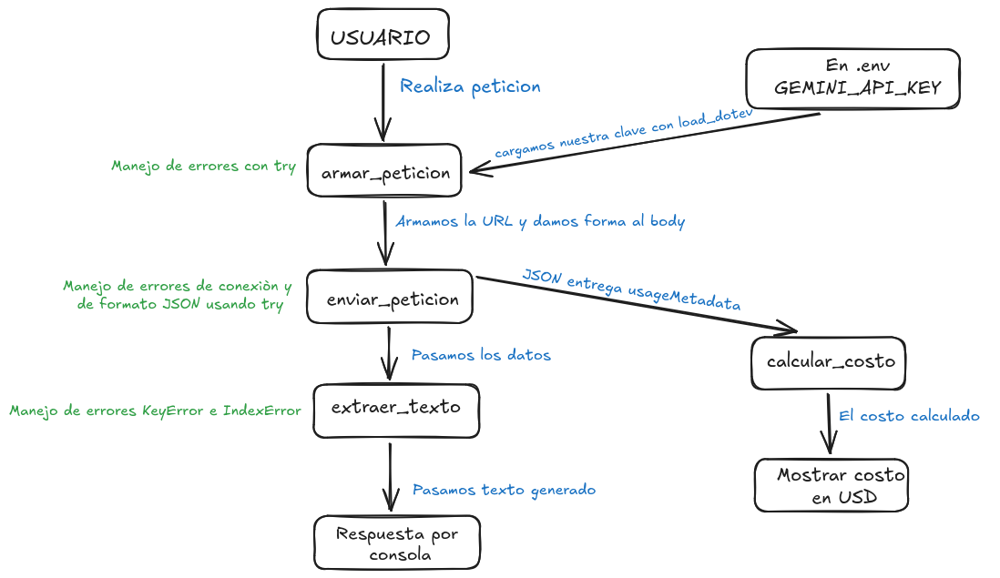

# Decisión de arquitectura: elección de modelo

## Modelo elegido
**gemini-3.6-flash**

## Diagrama de arquitectura
El flujo completo de la miniaplicación, el uso de la clave de entorno cargada con `load_dotenv`, la secuencia de llamadas y el manejo de excepciones implementado se representan en el siguiente diagrama:

*Estructura del flujo:*
- **Entrada:** El usuario realiza la petición enviando la pregunta.
- **Construcción:** `armar_peticion` valida que la pregunta no esté vacía (`try / if not pregunta`), toma la clave `GEMINI_API_KEY` desde el archivo `.env` y retorna la URL con el body.
- **Envío:** `enviar_peticion` gestiona la llamada HTTP con control de errores de red, timeout y código 200.
- **Consumo de datos:** Se extrae el texto final con `extraer_texto` (controlando `KeyError` e `IndexError`) y en paralelo `calcular_costo` procesa los tokens de `usageMetadata` para emitir el costo en USD.

---

## Comparación de candidatos

Las pruebas se ejecutaron mediante el script `src/evaluacion_modelos.py` con 4 peticiones consecutivas por modelo para evaluar latencia, costo unitario y estabilidad:

| Métrica / Parámetro | gemini-3.6-flash (Candidato 1) | gemini-3.5-flash (Candidato 2) |
| :--- | :--- | :--- |
| **Precio entrada (por token)** | $0.00000010 USD | $0.00000075 USD |
| **Precio salida (por token)** | $0.00000030 USD | $0.00000375 USD |
| **Latencia Intento 1** | 3.28 s | 3.69 s |
| **Latencia Intento 2** | 2.43 s | 2.76 s |
| **Latencia Intento 3** | 2.67 s | 2.46 s |
| **Latencia Intento 4** | 2.85 s | 3.12 s |
| **Costo Intento 1** | $0.000086 USD | $0.001132 USD |
| **Costo Intento 2** | $0.000080 USD | $0.001241 USD |
| **Costo Intento 3** | $0.000100 USD | $0.001180 USD |
| **Costo Intento 4** | $0.000098 USD | $0.001215 USD |
| **Latencia promedio** | **2.81 s** | **3.01 s** |
| **Costo acumulado (4 peticiones)** | **$0.000364 USD** | **$0.004768 USD** |
| **Estabilidad de ejecución** | 4 / 4 exitosos | 4 / 4 exitosos |

---

## Justificación
Para la arquitectura de la miniaplicación se ha seleccionado **gemini-3.6-flash** por los siguientes motivos técnicos y operativos:

1. **Eficiencia en costos:** Presenta un costo acumulado de **$0.000364 USD** frente a los **$0.004768 USD** de `gemini-3.5-flash`. El modelo seleccionado es más de **13 veces más económico** sin sacrificar precisión en las respuestas de verificación solicitadas.
2. **Latencia más baja y consistente:** Logró un promedio de **2.81 segundos** (con respuestas de hasta 2.43 s), manteniéndose por debajo de la media de 3.01 s del modelo alternativo.
3. **Escalabilidad:** Al requerir un menor presupuesto de tokens por consulta y responder de forma más ágil, reduce el riesgo de congestión y aprovecha mejor los límites de tasa de la API.

---

## Alternativa descartada y por qué
Se descartó **gemini-3.5-flash** debido a:

* **Mayor latencia:** Promedió 3.01 segundos por solicitud sin aportar valor agregado en velocidad de inferencia.
* **Costo desproporcionado:** El valor de salida ($0.00000375 USD) eleva el gasto operativo innecesariamente para peticiones puntuales y estructuradas, representando un margen económico desfavorable frente a la versión elegida.